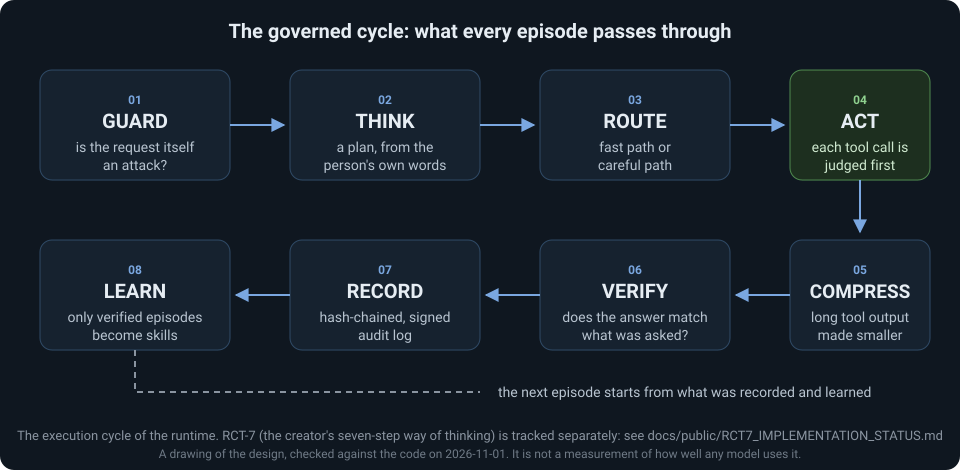
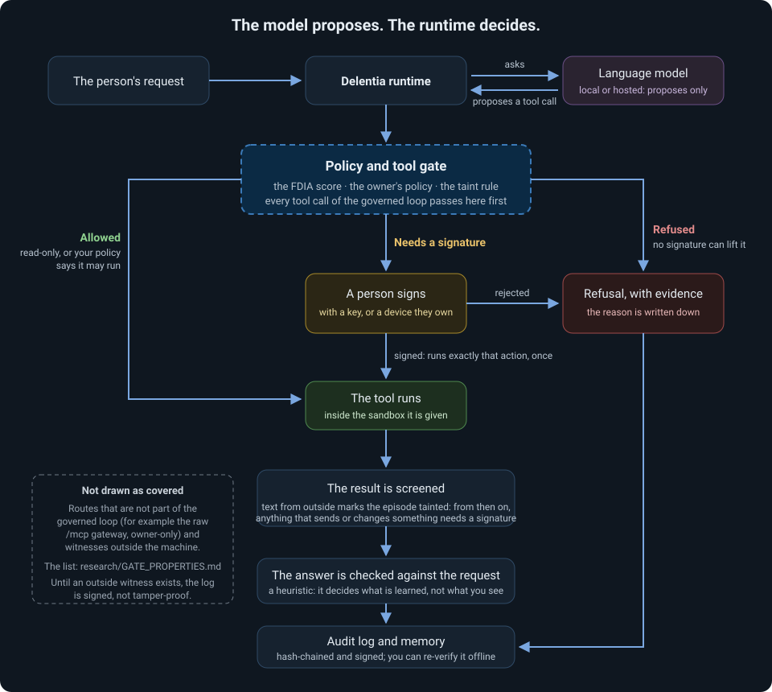

# Delentia OS

[](https://github.com/delentia-labs/Delentia-OS/actions/workflows/ci.yml)
[](https://pypi.org/project/delentia-os/)
[](https://github.com/delentia-labs/Delentia-OS/releases/latest)
[](pyproject.toml)
[](LICENSE)
[](docs/KNOWN_LIMITATIONS.md)

**A self-hosted AI agent runtime in which the model only proposes. Every tool call is judged before it runs, anything that writes, sends or runs code waits for a person's signature, and every episode leaves a record you can verify.**

AI agents can plan and use tools. What happens when the model misreads you, reads a hostile web page, or the process dies halfway through a job? Most setups rely on the model behaving. Delentia OS does not: the runtime sits between the model and the tools and decides.

**What you can explore**

- **Governed tool use.** A gate (a score, your own policy, and a rule about untrusted text) judges each call. Reading is quiet; writing, sending and running code stop and wait for a signature from a key or a device you own.
- **A rule for hostile content.** Text that comes from outside (a web page, a file in an untrusted folder, a message) marks the episode as *tainted*. From then on, anything that could send or change something needs a signature, whatever the model says.
- **Verifiable records.** Each episode is written to a hash-chained, signed audit log you can re-check offline.
- **Recovery.** An interrupted episode can be continued, and a retried call carries the key of the call it retries (tested with a scripted model).
- **Your model, your machine.** A local model (Ollama), any OpenAI-compatible endpoint, or OpenRouter. Nothing runs anywhere except where you install it.

[Run the demo (no model, no key)](#try-it-in-two-minutes-no-model-no-api-key) · [See what a run prints](docs/demo/SAMPLE_OUTPUT_EN.md) · [What is measured, and what is not](#what-is-measured-and-what-is-not) · [Known limitations](docs/KNOWN_LIMITATIONS.md) · [Reference](docs/reference/index.md)

## The governed cycle

<p align="center"></p>

**GUARD** (is the request itself an attack?) → **THINK** (a plan) → **ROUTE** (fast or careful) → **ACT** (each tool call is judged first) → **COMPRESS** (long tool output is made smaller and stays recoverable) → **VERIFY** (does the answer match what was asked?) → **RECORD** (a signed, hash-chained audit log) → **LEARN** (only verified episodes become skills).

This is the runtime's execution cycle. RCT-7, the creator's seven-step way of thinking, is a separate thing and is tracked separately: steps 4 to 7 do not yet meet its definition ([status, step by step](docs/public/RCT7_IMPLEMENTATION_STATUS.md)).

## Where the model stops and the runtime decides

<p align="center"></p>

The model proposes; the runtime enforces. The drawing shows the governed loop. It does **not** claim that every route into the system passes the gate: routes outside the loop (for example the raw `/mcp` gateway, which is owner-only) are listed in [`research/GATE_PROPERTIES.md`](research/GATE_PROPERTIES.md), and until a witness outside the machine exists the log is hash-chained and signed, **not** tamper-proof.

## Install

| You are | Start here |
|---|---|
| **On Windows, no Python** | [**Download Delentia-Setup.exe**](https://github.com/delentia-labs/Delentia-OS/releases/latest/download/Delentia-Setup.exe), double-click it, then start **Delentia** from the Start menu. It installs for your account only (no administrator rights, nothing starts by itself, uninstalling never touches your data in `%USERPROFILE%\.delentia`) and needs the internet while installing. It is **not code-signed yet**, so Windows SmartScreen will warn: check the download against the published [`SHA256SUMS.txt`](https://github.com/delentia-labs/Delentia-OS/releases/latest/download/SHA256SUMS.txt) first. Step by step: [English](docs/demo/INSTALL_WINDOWS_EN.md) · [ภาษาไทย](docs/demo/INSTALL_WINDOWS_TH.md) |
| **A Python user** (3.10 or newer) | `pip install delentia-os`, then `delentia setup`, `delentia serve`, `delentia desk` |
| **Using a local model** | The same, with [Ollama](https://ollama.com/download) installed: `delentia setup` helps you choose a model that answers |
| **A contributor** | `git clone https://github.com/delentia-labs/Delentia-OS`, `pip install -e .`, then [CONTRIBUTING.md](CONTRIBUTING.md) |
| **A researcher** | The demo below, then [`research/`](research/) and the [results register](research/RESULTS_PUBLIC.md) |

> The Windows installer is attached to every release from **2.4.0** on (2.3.1 and earlier have no installer and no Desk pages). Optional extras: `delentia-os[video]` (OpenCV), `delentia-os[vector]` (faiss). Install scripts for Linux, macOS and PowerShell exist in the repository ([`install.sh`](install.sh), [`install.ps1`](install.ps1)); read them before running anything piped from the internet.

**Versions.** The package follows [Semantic Versioning](https://semver.org/) and only goes up. "*Public Technical Preview 0.1*" (Thai: *รุ่นทดลองเชิงเทคนิคสำหรับสาธารณะ 0.1*) is the name of a stage (what is opened to whom, see [`docs/release/RELEASE_LEVELS.md`](docs/release/RELEASE_LEVELS.md)), not a version number; `delentia --version` shows the version. More: [`docs/release/VERSIONING_POLICY.md`](docs/release/VERSIONING_POLICY.md).

## Try it in two minutes: no model, no API key

```bash
pip install delentia-os
delentia demo init --lang en                # a folder with three sample vendor quotes and a demo approver key (the default language is Thai: leave out --lang en for that)
delentia demo run compare --scripted        # the agent reads the quotes, answers, and the answer is checked against what is known to be true
delentia demo run edit --scripted           # asks to change a file: the agent STOPS and waits for a signature
delentia demo approve <id> --scripted       # you sign; only now does the file change
delentia demo run injection --scripted      # a hijacked model obeys a note hidden in a quote: watch the gate stop it
delentia demo status                        # the audit chain: how many rows, how many signed, intact or not
```

> **Version note.** `--lang en` and `delentia demo run injection --scripted` are in **2.4.1 and later**. On 2.4.0 the demo exists in Thai only; leave out `--lang en` there. `delentia --version` tells you which you have.

Not ready to install anything? [Here is what these commands print](docs/demo/SAMPLE_OUTPUT_EN.md) (a real run; [the Thai run](docs/demo/SAMPLE_OUTPUT.md)).

`--scripted` means a fixed program stands in for the **model** and nothing else: the files, the tools, the safety gate, the wait for a signature, the signature check and the audit log are real. It shows the mechanism without a model installed. It says nothing about how good any model is, and every report says so on its first line.

**Prefer a web page?** In one window run `delentia serve`, in another `delentia desk`: it opens the Desk in your browser (what the agent did, what waits for you, memory, models). A risky action can be approved from the Desk with a device you already own (Windows Hello, a fingerprint, a phone): [how](docs/demo/APPROVE_WITH_DEVICE_TH.md) (Thai). **To use a real model:** `delentia setup`, then the same commands without `--scripted` (a local Ollama model or any OpenAI-compatible endpoint).

## What is measured, and what is not

| Evidence | Where it stands |
|---|---|
| The public test suite | **9,069 passed, 46 skipped, 0 failed, 91.95% coverage** ([CI run](https://github.com/delentia-labs/Delentia-OS/actions/runs/40989051697), commit `dc0b2df`, 2026-10-30). A checkpoint that is updated by hand, not live. It is evidence about the code, not about how well a model uses it |
| The gate against a scripted attacker | A model that obeys every injected instruction: of 23 scenarios, 3 harmful side effects ran with the taint rule off and **0 with it on**, while 6 of 6 legitimate workflows still ran ([method and limits](docs/security/THREAT_MODEL.md)) |
| Signed approvals, the audit chain, recovery after a crash | Tested with a scripted model, including a hard kill at three points and a forged answer on its way back |
| Small local models | They complete some simple tasks, not reliably: on a five-goal probe qwen2.5:7b did 3, llama3.2:3b 0, qwen3:8b 4 (one machine, one run each) |
| **A strong hosted model driving the runtime** | **No result yet.** Everything above uses a scripted model or a small local one |
| **Independent reproduction** | **None yet** |
| An outside witness for the audit chain | Built (a public git ledger, a time-stamp authority, a Cloudflare Worker) but not independent of the author: until it is, the log is hash-chained and signed, **not** tamper-proof |
| The Windows installer | Built and run on a clean CI runner; not code-signed; not yet run on a second person's computer |
| Production readiness | **Not declared.** Experimental research software |

Every measurement is entered in [a register](research/RESULTS_PUBLIC.md) with the commit it ran on, the rule written before it ran and what it cost. Details and history: [`docs/testing/TESTING_CANONICAL.md`](docs/testing/TESTING_CANONICAL.md), [`CHANGELOG.md`](CHANGELOG.md), [`docs/COMPARISON.md`](docs/COMPARISON.md) (how this differs from the nearest projects).

## What is in this repository

| In | What |
|---|---|
| **The open-source runtime** (Apache 2.0) | The agent runtime (`rct_control_plane/`), the Desk web pages, the Windows installer, 41 algorithm modules (only some run inside the loop), the SDK modules and 5 reference microservices |
| **Optional** | Local or hosted models, other MCP servers through the same gate, web search, chat channels (each closed until you name who may use it), the jury runner |
| **Experimental** | RCT-7 steps 4 to 7, the model-assisted judge and critic, the Law Pack, memory by meaning |
| **Not included** | A separate, proprietary service layer that lives in a private repository and is not part of this release. No hosted service: nothing here runs anywhere except on your machine |

> **Enterprise** (not in this repository) means that separate proprietary layer; this repository does not offer it as a running service. The runtime can use any HTTP service that publishes an OpenAPI document, through the same gate (`python -m rct_control_plane.openapi_mcp_bridge --help`).

Two companion repositories: **Delentia Guard** (a policy filter in front of any MCP server, npm `delentia-guard`) and the **Delentia MCP connector** (six advisory tools, npm `delentia-mcp`), both in [delentia-mcp](https://github.com/delentia-labs/delentia-mcp).

## What Delentia is, and what RCT-7 and the FDIA Equation are

**Delentia OS is an experimental, open-source, self-hosted, intent-centric AI agent runtime.** The agent loop, tools, memory, skills, schedules and subagents live inside it, and every episode passes the cycle above. You choose the model and you run the installation. It is a research project by one creator, not a commercial product, and it is not production-stable for critical workloads. It does not change a language model's weights: it governs what an agent is allowed to do and keeps evidence of what it did. The one-page definition, with the history and what is still to be tested: [`docs/public/CURRENT_PUBLIC_INFORMATION_EN.md`](docs/public/CURRENT_PUBLIC_INFORMATION_EN.md) ([ภาษาไทย](docs/public/CURRENT_PUBLIC_INFORMATION_TH.md)).

- **FDIA Equation, `F = (D^I) × A`.** It began as a framework about the future: **F**uture (the outcome that actually happens), **D**ata (reality and experience, good and bad), **I**ntent (the exponent that gives the data direction) and **A**rchitect (the human who designs, decides and answers for the outcome). The equation has no official expanded name. In this runtime it is read as an admissibility score for an action, used together with the owner's policy and signed human approvals; the score alone is not what stops an action. Inside the gate D is a number between 0 and 1, so a larger I makes F *smaller* for the same D: a clearer, more demanding intent needs better data to pass. When A = 0 the formula gives F = 0 and the gate refuses, on every code path that applies the gate: this is an invariant of those paths, not a guarantee about every path or about what a model writes. [The full explanation](docs/reference/fdia-equation.md).
- **RCT-7, Reverse Component Thinking.** A way of working in seven steps: observe, analyze, deconstruct, reason backward from the wanted result, identify the core intent, reconstruct (show the plan before building), and compare the result with the intent (stop and ask when it does not match). **This is the design. The runtime implements parts of it; steps 4 to 7 do not yet meet the creator's definition.** [The checklist](docs/public/RCT7_IMPLEMENTATION_STATUS.md).

## Architecture and reference

The README is a short entrance. The detail lives in the documentation:

- [Reference index](docs/reference/index.md): [the FDIA Equation](docs/reference/fdia-equation.md), [runtime features](docs/reference/runtime-features.md) (data residency, API hardening, the owner's policy, MCP, Tool Forge), [SDK modules and components](docs/reference/sdk-and-components.md), [earlier README content](docs/reference/legacy-numbers-and-history.md) (key numbers, the older layer diagram, install variants, the project structure and the timeline, with dated corrections)
- [Whitepaper 3.0](docs/whitepaper/DELENTIA_WHITEPAPER_3.0_EN.md) ([ภาษาไทย](docs/whitepaper/DELENTIA_WHITEPAPER_3.0_TH.md)): the current single source for the design, the measured evidence and the withdrawn claims
- [Threat model](docs/security/THREAT_MODEL.md) · [Known limitations](docs/KNOWN_LIMITATIONS.md) · [Release levels](docs/release/RELEASE_LEVELS.md) · [Release readiness checklist](docs/release/RELEASE_READINESS_CHECKLIST.md) · [Public release provenance](docs/release/PUBLIC_RELEASE_PROVENANCE.md)
- [Documentation site](https://delentia-labs.github.io/Delentia-OS/) · [Website](https://delentia.com)

## Community

Bug reports and install reports are welcome through the [issue forms](https://github.com/delentia-labs/Delentia-OS/issues/new/choose); a question or an idea belongs in [Discussions](https://github.com/delentia-labs/Delentia-OS/discussions). How to contribute: [CONTRIBUTING.md](CONTRIBUTING.md). **Security findings:** see [SECURITY.md](SECURITY.md) and do not open a public issue.

## About the creator

**Ittirit Saengow (อิทธิฤทธิ์ แซ่โง้ว)**, thinker and creator of Delentia, Klong Toei, Bangkok. The creator's account: the work, including the FDIA Equation and RCT-7, began on **28 June 2025**, on paper and in conversations with ordinary AI chat, with the question "What is the future?" and later a second one: if an AI agent is to work through a way of thinking we design, how can a human keep authority over what it does? **11 August 2025** is a separate personal turning point, not the date the equation was first written. No independent timestamp of the original paper exists, so the dates are the creator's account. The whitepapers are the history of the design, not evidence that every statement in them has been tested.

[GitHub @ittirit-delentia](https://github.com/ittirit-delentia) · [LinkedIn](https://www.linkedin.com/in/ittirit-saengow/) · [X @ittirit_rct](https://x.com/ittirit_rct) · [Reddit u/WindLate5307](https://www.reddit.com/user/WindLate5307/) · [Bio](https://ittiritsaengow.link) · founder@delentia.com. The timeline of the project is in the [earlier README content](docs/reference/legacy-numbers-and-history.md); what comes next is in [ROADMAP.md](ROADMAP.md).

## The Delentia ecosystem

| Repository | Purpose | Status |
|---|---|---|
| [Delentia-OS](https://github.com/delentia-labs/Delentia-OS) | Agent runtime and core SDK, with the GUI (`apps/gui`), the adapter registry (`plugins/adapters`) and public deployment files (`deploy/`) | ✅ Apache 2.0 |
| [delentia-mcp](https://github.com/delentia-labs/delentia-mcp) | MCP server (6 tools on Cloudflare Workers) and Delentia Guard | ✅ Apache 2.0 |
| [Delentia-AI-SLM](https://github.com/delentia-labs/Delentia-AI-SLM) | SLM fine-tuning experiments | 🗄️ Archived |
| [Delentia-Infra-Enterprise](https://github.com/delentia-labs/Delentia-Infra-Enterprise) · [Delentia-Private-OS](https://github.com/delentia-labs/Delentia-Private-OS) | Enterprise infrastructure and platform | 🔒 Proprietary |
| [Delentia-Website](https://github.com/delentia-labs/Delentia-Website) | Marketing and documentation site (Next.js, Vercel) | 🔒 Proprietary |

## License

Apache 2.0, see [LICENSE](LICENSE). Copyright 2026 Ittirit Saengow (อิทธิฤทธิ์ แซ่โง้ว), Delentia Labs. Made in Bangkok, Thailand.
