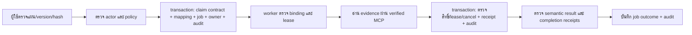

# Bounded read-only background jobs — 30 ตุลาคม 2026

## ขอบเขตและฐานการพัฒนา

รอบนี้ต่อจาก combined revision `51713f9168ec7311b3fea89a249f2a3783631825` ซึ่งรวม runtime ของ PR #202–#205 สำหรับตรวจการประกอบกัน งานเหล่านั้นยังต้องผ่าน review/CI และยังไม่ถือว่ารวมเข้า main แล้ว ฐาน main ที่ตรวจจาก GitHub คือ `dc0b2df373a29edad6d9b328fbcf2e0a73910038`.

เป้าหมายคือให้ contract ตรวจงบที่ผู้ใช้เห็นแผนแล้วทำงานเบื้องหลังได้ โดยใช้ `JobService` เดิม ไม่เปิด generic agent API และไม่เพิ่ม planner อีกชุด งานนี้ไม่เปลี่ยน hooks ของ plan approval ที่ Claude ดูแล ไม่แก้ Desk หรือ research runners ของ Claude.

## HTTP protocol

ต้องเปิด profile `readonly_budget_v1` ด้วย operator policy เดิม ใช้ named bearer identity และ workspace/file grant เดิม `ROUTE` คือ `/v1/agent/readonly/budget`.

| Method / path | ความหมาย |
| --- | --- |
| `POST ROUTE` | สร้าง/เรียกคืนแผนก่อนอ่านหลักฐาน; `request_id` ใช้ idempotency เดิม |
| `GET ROUTE/{contract_id}` | อ่าน contract ที่ identity นี้มีสิทธิ์ |
| `POST ROUTE/{contract_id}/confirm` | ทาง synchronous เดิม; ห้ามแข่งขันกับการ submit job ของแผนเดียวกัน |
| `POST ROUTE/{contract_id}/jobs` | ยืนยันแผนปัจจุบันและจอง background job แบบ atomic; HTTP 202 |
| `GET ROUTE/jobs/{job_id}` | อ่านสถานะ job พร้อม public contract/receipts |
| `DELETE ROUTE/jobs/{job_id}` | ขอ cancel; อ่านสถานะต่อจน owner ยืนยันหรือเป็น interrupted |

ตัวอย่าง body ของการ submit job ใช้ค่า version/digest จากผลสร้างแผนจริง:

```json
{
  "schema_version": "1",
  "version": 1,
  "plan_sha256": "<64 lowercase hex characters from the reviewed plan>"
}
```

ไม่รับ `goal`, handler, tool, actor หรือ workspace เพิ่มใน body นี้ ผลตอบกลับมี `schema_version`, `job_id`, `status`, `task_outcome`, `cancel_requested`, `verified` และ `contract` ที่ใช้ public receipt schema เดิม เวลา nanoseconds เป็น string และมี canonical `hashed_payload_json` สำหรับตรวจ hash ข้ามภาษา.

`status=done` หมายถึง runner คืนผล ส่วน `verified=true` ต้องมีทั้ง job outcome ที่ตรวจแล้วและ contract ที่จบพร้อม receipts ครบ ขอบเขตการตรวจยังเป็น bytes ของเอกสารและเลขคณิตสกุลเงินเดียวกัน ไม่รับรองความจริงของใบเสนอราคาหรือเจตนาทั่วไป.

## การผูกสิทธิ์และ transaction



- mapping มี unique key `(namespace, contract_id, review_version)` การ submit ซ้ำคืน job เดิม การแข่งขันจาก API สอง instances ไม่สร้าง execution ใหม่ หาก quota หรือ audit insert ล้มเหลว การ claim และ mapping ย้อนกลับทั้งหมด
- worker ไม่รับ arbitrary goal แต่รับ identifiers ของ contract ที่จองไว้ ตรวจ actor, policy digest, plan digest, claimed version และ state ก่อน execute
- ตรวจ operator policy และทะเบียน named actors ซ้ำก่อนอ่านและก่อน contract transitions การ revoke ผู้ใช้หรือเปลี่ยน policy ระหว่างอ่านไม่อนุญาตให้ commit receipt ต่อ
- `ContextVar` ผูก guard กับ task ของ execution นี้ และ `BEGIN IMMEDIATE` ทำให้การตรวจ job ownership/cancel กับการเขียน contract อยู่ใน transaction เดียวกัน การตรวจด้วย SELECT ก่อนเริ่ม transaction อย่างเดียวไม่เพียงพอ
- actual MCP call จำกัดไว้ที่ `delentia_read_repo_file` ของ evidence ที่ระบุและต้องมี `verified_read=true` เส้นทาง source acquisition เดิมยังคง descriptor-relative no-follow checks
- profile นี้เป็น deterministic/model-free executor หาก host เปิด auxiliary pipeline หรือ model jury จะปฏิเสธ configuration นั้น ไม่ข้าม policy เพื่อฝืน execute
- job submission/start/finish/failure/cancel/recovery audit เปลี่ยนจาก best-effort เป็น commit พร้อม state บน SQLite เดียวกัน ถ้าบันทึก audit ไม่ได้ต้องไม่รายงานการเปลี่ยนสถานะสำเร็จ

## Recovery และข้อจำกัด

owner ที่ยังมี lease ไม่ถูก service instance ใหม่ยึดงาน owner ที่หายหรือ lease หมดเป็น interrupted ตามกลไก #205 ไม่ replay ให้อัตโนมัติ เมื่ออ่าน status ของ terminal job ที่ contract ยัง running จะ reconcile เป็น interrupted โดยรักษา receipts ที่บันทึกแล้วไว้ จึงมีการเขียน metadata ภายใต้ status lookup.

ถ้า crash หลัง contract จบแต่ก่อนบันทึก job outcome ผล contract อาจแสดง verified แต่ผล job ระดับบนยังไม่ verified ต้องตรวจทั้งสองส่วน ไม่ใช้ contract เพียงตัวเดียวประกาศว่างานเบื้องหลังสำเร็จครบวงจร.

นี่เป็น fencing ของฐานข้อมูล ไม่ใช่ exactly-once ของ external effects การ cancel เรียกคืน bytes ที่อ่านไปแล้วหรือหยุดทุก thread ไม่ได้ ไม่เปิด write workflow และไม่ resume interrupted contracts ผ่าน endpoint ใหม่นี้ ทาง synchronous เดิมไม่ใช่ background lease protocol ต้อง drain worker เก่าที่ไม่รู้จัก fencing ก่อน upgrade.

mapping ใหม่ไม่เก็บ bearer, raw evidence หรือ goal ซ้ำ แต่ยังมี namespace/identifiers/digests การกำหนด retention ของ metadata/tombstones ระยะยาวยังเป็นงานต่อ ห้ามกล่าวว่า erase ลบข้อมูลเชื่อมโยงทุกชนิดหรือสำเนา backup แล้ว.

POSIX verified-read backend ที่ไม่รองรับจะตอบ 501 ก่อน admit job Windows native ยังต้องใช้ backend ที่มี primitive นี้ เช่น Linux container ไม่ลดการป้องกันเพื่อให้ทดสอบผ่าน.

## หลักฐานการตรวจ

ทดสอบเฉพาะส่วนใหม่ 22 กรณีผ่าน รวม real `AlgorithmKernel41` ที่ตั้ง provider ให้ล้มทันทีหากมี generation, duplicate admission สอง API instances, stale/foreign confirmation, cancellation, policy/actor/lease loss หลังอ่าน source, unsupported backend, incompatible jury/pipeline และ audit rollback ผลนี้เป็น cloud engineering result ไม่ใช่ public CI checkpoint ของ main.

Full suite ของ source checkpoint `d635c698` ได้ **9,130 passed / 10 failed / 45 skipped / 1 xfailed**, 558.56 วินาที: 9 failures มาจาก Ollama ไม่มีโมเดลและ endpoint ตอบ 404; อีก 1 crawler failure ยืนยันด้วย MCP โดยตรงว่า native DNS ล้มเหลวและ `url_safety` ปฏิเสธก่อน fetch ไม่ลดการป้องกันเพื่อให้ผ่าน

ระหว่างรัน main รวม #200/#201 เป็น `368537d5` จึง merge dependency updates นี้เข้า branch หลัง full suite แล้ว ทั้งสอง package versions (`nltk=3.10.4`, `msgpack=1.2.3`) มีอยู่ใน environment ที่ใช้ full suite อยู่ก่อนแล้ว ไฟล์ runtime/tests ที่ตรวจ hash ตรงกับ checkpoint ที่ทดสอบทั้งหมด ผล full suite ไม่ได้รันซ้ำทั้งชุดหลัง merge เฉพาะ dependency manifests; มี regression หลัง merge แยกต่างหาก **147 passed** ใน 7.84 วินาที ครอบคลุม bounded jobs, ownership/cancel, HTTP authorization/idempotency, atomic audit และ receipt lifecycle

ผล full suite และ checksum ของไฟล์ที่ทดสอบบันทึกใน [evidence JSON](evidence/BOUNDED_JOBS_2026-10-30.json) ประกอบ PR; ห้ามใช้ผลก่อนการแก้ transaction guard เป็นผลของ revision สุดท้าย รายละเอียดการไปสู่ paid evaluation และ pilot อยู่ใน [แผนก่อนใช้ OpenRouter](PREPAID_EVALUATION_AND_MARKETING_GATES_2026-10-30_TH.md).
