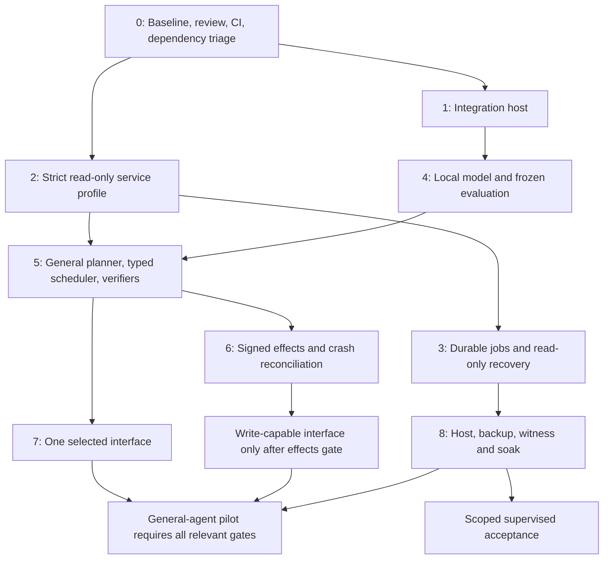

# ข้อมูลรวมและแผนพัฒนา DELENTIA หลัง PR #168

จัดทำ 23 ตุลาคม 2026 ตามเวลา Asia/Bangkok จาก checkout `bdf1f3733d3b7af66ba6aa225b7c5a8597318dc5`, ผลทดสอบรอบ verified-budget และ GitHub API ที่ตรวจได้จริง เอกสารนี้เป็นแผนตรวจรับ ไม่ใช่รายงานว่าทำรายการในอนาคตเสร็จแล้ว

## 1. คำจำกัดความสถานะปัจจุบัน

DELENTIA เป็น experimental governed runtime ที่มี code execution, policy/gates, persistence, journal/approval/notary mechanisms เดิม และมี RCT contract workflow เพิ่มขึ้นตามลำดับ มีบริการตรวจงบแบบ read-only ที่รันจริงผ่าน CLI/kernel/MCP/SQLite และตรวจผลตัวเลขได้ในขอบเขตหนึ่ง ยังไม่มีหลักฐานว่า RCT-7 ทั่วไปทำงานครบทุกโจทย์/ทุกช่องทาง หรือพร้อม production/pilot

ไม่ควรกำหนดเปอร์เซ็นต์ความสำเร็จทั้งโครงการจากจำนวน tests เพราะ tests ของ governance, packaging และ typed arithmetic ไม่ได้วัดความเข้าใจโจทย์ทั่วไปหรือ reliability บน host จริง ใช้ gate และหลักฐานแยกตาม surface แทน

### สถานะที่ยืนยันและอายุหลักฐาน

| เรื่อง | หลักฐาน/ผล | ข้อจำกัด |
|---|---|---|
| GitHub API | อ่าน repository และสร้าง PR ได้หลังผู้ใช้ปรับ environment | ไม่ใช่หลักฐานว่า DNS/browser/model prerequisites กลับมาพร้อมด้วย |
| PR | [Draft #168](https://github.com/delentia-labs/Delentia-OS/pull/168), OPEN, MERGEABLE ตอนตรวจ | ไม่ได้ merge; mergeable ไม่ได้หมายถึง CI ผ่าน |
| PR checks | 16 checks อยู่ในคิวตอนตรวจ | ยังไม่มีผลผ่าน; ต้องอ่านผลของ head ใหม่ทุกครั้ง ไม่รวมผลต่าง SHA |
| Local full Python | 7,975 passed / 13 failed / 59 skipped / 1 xfailed, 716.22 วินาที, exit 1 | เป็นรอบก่อน model pull; ไม่ใช่ combined-tree CI result |
| Coverage | 91.24% ตาม config ที่รวม test modules | ไม่ใช่ production-only coverage หรือ semantic accuracy |
| Focused tests | 290 passed; publication recheck 32 passed | จำนวนซ้อนกับ full suite ไม่บวกเข้าด้วยกัน |
| Pipeline | 21 cases / 134 checks ผ่าน | ไม่รัน optional subagent cases |
| Actual CLI | สองกรณีเลขงบผ่าน, generation calls=0, receipts 7 ต่อกรณี | ไม่ใช่ผล capable-model evaluation |
| Wheel | ติดตั้งแล้ว CLI จากนอก checkout ผ่าน | local artifact ไม่ใช่ release ใหม่บน registry |
| Model download | ครั้งล่าสุดที่เก็บผล pull ไม่สำเร็จ: CDN proxy no route to host; tags ว่าง | สถานะนี้ต้อง recheck หลัง environment เปลี่ยน; ไม่อนุมานจาก GitHub API ที่ใช้ได้ |
| Browser/DNS | failures เดิม 3/1 กรณีตามลำดับ | ยังไม่ได้ revalidate ในรอบจัดทำแผนนี้ |
| Dependency alerts | push response รายงาน 47 บน default branch: 7 critical / 25 high / 15 moderate | เป็น server summary ก่อนหน้า ไม่ใช่ branch-specific reachability audit หรือ inventory ล่าสุด |

### แผนที่ code และเอกสาร

| ส่วน | ใช้อะไรที่มีอยู่ | พัฒนาต่อโดยไม่สร้างเส้นทางลัด |
|---|---|---|
| Goal/contracts | `intent_contract.py`, `rct_plan.py` | schema/version, context revisions, lifecycle และ authorization |
| Plan inference | `semantic_plan.py`, `derived_plan.py` | general decomposition, uncertainty และ backwards conditions |
| Execution | `autonomous_loop.py`, `governed_autonomous_loop.py`, `verified_budget.py` | typed handler/scheduler ที่ยังผ่าน gate เดิม |
| Evidence/verdict | strict quote schema, pinned hash, Decimal, final freshness check | source trust/conflicts, domain oracles, consistent public verdict |
| Persistence/recovery | contract store, `episode_journal.py`, approvals/queue/notary | contract-aware effect bindings และ crash reconciliation |
| Interfaces | CLI/API contract path; Desk/jobs/cron/gateways มีเส้นทางเดิม | plan/wait/continue/status แยกแต่ละช่องทาง |
| Release | release levels/operator/research protocols เดิม | evidence ของ exact revision + target host + profile |

Source files อยู่ใน `rct_control_plane/`. อ่าน [entrypoint coverage](RCT_ENTRYPOINT_COVERAGE_TH.md), [ผลล่าสุด](VERIFIED_BUDGET_RESULTS_2026-10-23_TH.md), [evidence JSON](evidence/VERIFIED_BUDGET_2026-10-23.json), [activation gates](../release/ACTIVATION_GATES_2026-10-23_TH.md) และ [release levels](../release/RELEASE_LEVELS.md) ประกอบ ข้อกำหนดของผู้ออกแบบเป็นเป้าหมาย ส่วนผลทดสอบเป็นหลักฐาน implementation ทั้งสองอย่างไม่ทดแทนกัน

## 2. RCT-7: ตอนนี้ทำอะไรได้และต้องเพิ่มอะไร

| ขั้น | สิ่งที่มีใน opt-in path | สิ่งที่ยังต้องพิสูจน์ |
|---|---|---|
| R1 Observe | facts/sources/unknowns แยกประเภท; อ่าน pinned JSON จริง | source identity, trust/freshness, contradictory observations และ unknowns ทั่วไป |
| R2 Analyze | rules แยก summary/budget, budget amount/currency | context relations, ambiguity, multi-intent, paraphrase และ material constraints ทั่วไป |
| R3 Deconstruct | criterion/task-specific components พร้อม dependencies | typed handlers สำหรับ task อื่นและ coverage ของทุก material criterion |
| R4 Reverse | prerequisite chain และ dependency checks ใน budget workflow | ค้น necessary conditions จากโจทย์ทั่วไปและตรวจความเพียงพอของ chain |
| R5 Core intent | critical-input wait, confirmed answers/revisions | สนทนาหลายรอบพร้อม invalidation และ reuse ข้อมูลที่ยังถูกต้อง |
| R6 Reconstruct | CLI/API visible plan, bounded execution และ partial receipts | generic scheduler, Desk/jobs/channels และ persistent status/continuation |
| R7 Compare | exact numeric report, source recheck, all-node receipts | semantics ใน domain อื่น, effects/recovery และ verdict/UI ที่ไม่ขัดกัน |

RCT-7 อยู่ในวงจร GUARD → THINK → ROUTE → ACT → COMPRESS → VERIFY → RECORD → LEARN ไม่ใช้ planning output เป็นสิทธิ์ลงมือเพิ่ม LEARN ไม่ได้แปลว่า train โมเดลหลักเอง และการแสดงแผนไม่ได้สร้างข้อบังคับขออนุมัติใหม่ทุกครั้ง: ใช้ policy ของ action จริงตามเดิม

## 3. เป้าหมายและการจัดลำดับ

เป้าหมาย A: workflow ตรวจยอด JSON เทียบงบแบบ read-only ที่เปิดให้กลุ่มจำกัดใช้ภายใต้การกำกับได้ หลังปิด profile/identity/recovery/operations gates เป้าหมายนี้ยังไม่รวม vendor authenticity, FX, ภาษีที่ต้องตีความจากเอกสารอิสระ หรือการซื้อจริง

เป้าหมาย B: agent ตาม RCT-7 ที่รับโจทย์หลากหลายได้ มี general planner/handlers/semantic verifiers, capable-model evidence และช่องทางที่ผ่าน tests ของตัวเอง หากเปิด write tools ต้องผ่าน signed-effect/reconciliation gates ก่อน

ต้องพัฒนาเป็นสองเส้นทางเพราะ A ให้ task outcome ที่นิยามและตรวจซ้ำได้ก่อน ส่วน B มีความไม่แน่นอนด้านความสามารถโมเดลและความเข้าใจโจทย์สูงกว่า ผลสำเร็จของ A ไม่ทำให้ G-model ของ B ผ่านโดยอัตโนมัติ และไม่เปลี่ยนนิยาม L2 เดิมโดยเงียบ ๆ

กราฟแสดง dependency ไม่ใช่กำหนดการเวลา งาน profile/schema/evaluation fixtures ทำต่อได้ขณะ host ถูกบล็อก แต่ full integration และ capable-model claims ต้องรอ prerequisite จริง

## 4. แผนปฏิบัติงานทีละรอบ

### รอบ 0 — ตั้ง baseline และทำให้ review มีข้อสรุป

1. ยืนยัน head SHA, main SHA, diff และผู้รับผิดชอบแต่ละส่วนก่อนเปลี่ยนโค้ดร่วมกับ Claude ไม่แก้ branch ของอีกฝ่าย ไม่ force-push ประวัติที่แชร์
2. ตรวจ Actions ของ PR #168: queued/running/failed/completed และ SHA หากคิวค้างให้ตรวจ runner availability, workflow approval, concurrency หรือ account limits จากข้อมูลจริง ไม่สันนิษฐานสาเหตุและไม่ข้าม checks
3. จัด findings แยก application defect / environment prerequisite / security dependency / intentionally optional พร้อม owner และ evidence
4. อ่าน Dependabot inventory ล่าสุด แยก manifest, installed version, fixed version, runtime reachability และ mitigation; review critical/high ก่อน release ไม่เท่ากับอัปเดต dependencies ทั้งหมดโดยไม่ทดสอบ
5. review cumulative PR ตาม contract authority → execution/source handling → tests → Action generated build → claims; ตัดสินวิธีรวม main แล้วทดสอบ revision รวมก่อน merge

ผลส่งมอบ: baseline manifest, review findings, dependency inventory และ CI evidence ของ exact head เกณฑ์จบ: ไม่มี failure ที่ไม่ทราบสาเหตุ และ required checks ผ่านจริงก่อน merge งานที่ต้องเปลี่ยนโค้ดให้แตกเป็น commit ตามเหตุ ไม่รวม cleanup ที่ไม่เกี่ยวข้อง

### รอบ 1 — ปิด prerequisites ของ integration

1. ตรวจ host DNS, proxy และ service/container configuration สดหลัง environment update; ตรวจเพียงชื่อ binding ไม่แสดง secret values
2. ตรวจพื้นที่ดิสก์/RAM จากเครื่องก่อน pull official model (~4.68 GB เฉพาะ blob ที่เคยเลือก); รักษา TLS/checksum แล้วตรวจ tags, model digest และ minimal inference จริง
3. รัน model integrations 9 กรณี แยก transport/timeout ออกจาก parse/tool-selection/capability failures ห้ามรับประกันว่า qwen2.5:7b จะผ่าน capability screen เพราะ download ผ่าน
4. จัด compatible host ให้ browser sandbox ใช้ได้ รัน TC027 และ browser tests ที่เคย skip โดยไม่ใช้ `--no-sandbox`
5. แก้ native DNS/egress แล้วทดสอบ web crawl ผ่าน actual tool รวม SSRF/DNS pinning negative cases
6. รัน full suite และรายงาน skip/xfail ตามความหมาย ไม่เปลี่ยน tests จริงเป็น fixtures เพื่อให้ผ่าน

ผลส่งมอบ: host/runtime manifest, successful prerequisite probes, integration logs และ full result ใหม่ เกณฑ์จบ: integrations ที่ profile ต้องใช้ผ่าน; optional surfaces ที่ไม่เปิดยังระบุว่าไม่ทดสอบได้ชัดเจน ไม่เรียก optional failures ว่า passed

### รอบ 2 — ปิดขอบเขตบริการตรวจงบรุ่นแรก

1. กำหนด versioned request/result/error schemas และ supported executor registry; unknown version ต้องปฏิเสธก่อน claim/dispatch
2. เพิ่ม server profile allowlist ของ routes, methods, tools และ workflow ปิด general fallback/write routes/jobs ที่ยังไม่รองรับ ไม่พึ่ง client เลือกโหมดให้ถูกเอง
3. แยก task outcome, criterion acceptance, evidence quality, legacy heuristic และ model evaluation ให้ public status ไม่ขัดกัน ไม่ force legacy verdict ให้ true
4. กำหนด canonical receipt encoding ข้ามภาษาและ migration ของ timestamp/int/hash ก่อนปล่อย client ให้คำนวณ hash ซ้ำ
5. กำหนด authenticated actor → namespace → workspace/file authorization ที่ server เลือกเอง ทดสอบสองผู้ใช้พร้อมกัน ไม่เปลี่ยน global root ต่อ request
6. harden actual MCP acquisition ด้วย safe descriptor handling ตาม target filesystem; ทดสอบ symlink/TOCTOU และข้อมูลที่อาจรั่วใน read result ไม่ตรวจเฉพาะ final success

ผลส่งมอบ: profile implementation, public contract, isolation tests และ migration note เกณฑ์จบ: mutation requests ไม่อาจหลุดไป generic/write path; unsupported input/executor fail closed; ไม่มี cross-user read/state leak; consumer เห็นสถานะและข้อจำกัดชัดเจน

### รอบ 3 — ทำ lifecycle ของงาน read-only ให้ทนต่อ interruption

1. ระบุ state machine ของ job และ contract รวม queued/running/waiting/terminal/unknown outcome ให้สอดคล้องของเดิม ไม่เพิ่มสถานะทับกันโดยไร้ migration
2. เพิ่ม request idempotency และ duplicate-delivery rules พร้อม status lookup, cancel และ continuation ที่ผูก actor/version
3. ทดสอบแยก process: kill ก่อน read, หลัง read ก่อน receipt, หลัง persist ก่อน response; restart ตอน wait; database lock, disk full และ response lost
4. recovery ต้องไม่ reset running แล้ว replay โดยเดา เพิ่ม operator reconciliation สำหรับผลที่ยังไม่ทราบ พร้อม durable reason

ผลส่งมอบ: recovery protocol, process tests และ operator commands เกณฑ์จบ: ทุก attempt ตรวจย้อนหลังได้ ไม่มี success ที่ receipts ไม่ครบ และไม่มี duplicate outcome ที่แอบซ่อนด้วย retry เส้นทางนี้ยังไม่รับรอง external write recovery

### รอบ 4 — Local model และ evaluation ที่ยึดหลักฐาน

เริ่มออกแบบ dataset ได้ตั้งแต่รอบ 0; รันโมเดลเมื่อรอบ 1 พร้อม ใช้ model/settings/code/schema/policy/protocol ที่ pin แล้วตาม research protocol เดิม

1. เก็บโจทย์ไทย/อังกฤษแบบ paired และโจทย์ธรรมชาติที่ไม่ใช่คำแปลตรง ครอบคลุม ambiguity, paraphrase, negation, multi-intent, missing data และ conflicting evidence
2. แยก development/holdout ก่อนปรับ planner/model prompts พร้อม expected outcomes ที่ผู้ตรวจอ่านได้
3. รัน capability batteries ตาม G-model/K.1.5 เดิม รวม 5-goal และ 17-goal พร้อม raw runs; threshold เดิม ≥90% ไม่ใช่ค่าที่ตั้งใหม่จากผลรอบนี้
4. วัด task success, false acceptance, clarification quality, semantic correctness, policy violations, latency และ resource usage แยกตามภาษา/ชนิดโจทย์
5. บันทึก infra failures ใน attempt ledger แยกจาก model mistakes; deterministic zero-generation demo ไม่รวมเป็น model success ไม่ใช้ repeated identical fixture เป็น independent evidence

ผลส่งมอบ: frozen evaluation manifest, raw outcomes/failure taxonomy และ model suitability decision เกณฑ์จบ: ผ่านเงื่อนไขของ workflow ที่จะเปิดและ protocol เดิม หาก local model ไม่ผ่านให้ลดขอบเขตหรือเลือกโมเดล local ที่ host รองรับ ไม่เริ่ม paid API โดยไม่มี authorization

### รอบ 5 — General RCT planner, execution และ domain verification

1. ทำ planner output เป็น typed IR ที่แยก original intent, confirmed revisions, facts, observations, assumptions, unknowns, criteria และ authority
2. เพิ่ม component handler registry พร้อม input/output schemas; ตรวจ cycle, missing dependency, unsupported handler และ criterion coverage ก่อน execution
3. ให้ R4 ย้อนจาก criterion → necessary conditions → observations/actions และ R5 ถามเฉพาะ unknown ที่มีผลต่อคำตอบ การเติมข้อมูลต้อง invalidate เฉพาะ dependent nodes ที่เกี่ยวข้อง
4. scheduler บังคับ readiness/completion receipt, bounded retry/time/size/cancellation; model proposal ไม่เพิ่ม permission หรือปิด verification เอง
5. เพิ่ม independent domain oracles ตาม use case ทีละอย่าง เช่น tax/discount/rounding ที่มี specification; ไม่ตีความเงื่อนไขที่ไม่ทราบเอง
6. R7 ตรวจ claim/evidence/result/effect ตามชนิดงาน และ mismatch ต้องแสดง difference/question แล้วหยุดเส้นทางที่ต้องรอจริง พร้อม no-positive-learning checks

ผลส่งมอบ: general IR/handler contract, bounded scheduler, domain oracle และ per-R1–R7 regressions เกณฑ์จบ: ทุก material criterion มี test/handler/receipt/verifier trace และ holdout ชี้ความสามารถจริงของขอบเขตที่ประกาศ ไม่ประกาศ universal semantic completeness

### รอบ 6 — Signed effects และ crash reconciliation

1. ใช้ approvals/notary/journal เดิม ผูก contract/version/plan/action/policy/actor/workspace/nonce/expiry เข้ากับสิ่งที่ลงนามและ actual dispatch
2. ระบุ effect inventory และ tool-specific idempotency/query/reconciliation capabilities; เริ่ม write workflow เดียวที่วัดผลปลายทางได้
3. ทดสอบ process crash ก่อน dispatch, หลัง effect ก่อน result persist, หลัง persist ก่อน acknowledgement และกรณี signature service/network ขัดข้อง
4. ปฏิเสธ stale/replayed/modified approvals; outcome unknown ต้องตรวจปลายทางหรือให้ operator reconcile ไม่ทำซ้ำโดยเดา

ผลส่งมอบ: signed-effect contract และ crash matrix ของ tool ที่เลือก เกณฑ์จบ: approval ไม่ย้ายไปใช้กับคำสั่งอื่นได้ และทุก crash boundary มีหลักฐาน reconciliation ก่อนเปิด write tools ให้ profile นั้น ไม่อ้าง exactly-once หากปลายทางไม่รองรับ

### รอบ 7 — ขยายช่องทางทีละตัว

แนะนำ Desk stream ก่อนเพื่อเห็น plan/difference/wait/receipt ได้ชัด หรือเลือก jobs ก่อนหากเป้าหมายแรกคือ durable background verification ต้องระบุทางเลือกหนึ่งใน implementation round ไม่ทำทุก surfaceพร้อมกัน

1. ออกแบบ visible events: plan, revised plan, waiting, component progress, verification และ terminal status พร้อม contract/job ids
2. เชื่อม continuation routing กับ authenticated identity และ version โดยไม่ใช้ข้อความตอบกลับที่อ้าง contract ของอีกคน
3. ทดสอบ plan-before-artifact, critical unknown→wait→answer→new plan, mismatch wait, stale/replay/cross-namespace refusal และ reconnect/restart
4. jobs/cron ต้องไม่สรุป waiting เป็น completed และต้องมีวิธีส่งคำถาม/รับคำตอบ/หมดอายุที่นิยามชัด ช่องทางที่ไม่เปิดให้ยังคงปิด

ผลส่งมอบ: entrypoint coverage matrix ที่อัปเดตด้วย evidence ของ surface จริง เกณฑ์จบ: shared loop ไม่ใช่หลักฐานแทน end-to-end ของช่องทางใหม่; write surface ต้องผ่านรอบ 6 ด้วย

### รอบ 8 — Host, operations และ supervised acceptance

1. สร้าง artifact/image จาก revision ที่ผ่าน checks พร้อม checksum/dependency manifest และทดสอบ clean install/upgrade/rollback บน target host
2. กำหนด operator, service identity, retention, data deletion, key backup/rotation/revocation และ incident/stop procedures ใช้ operator contract เดิมเป็นฐาน
3. วัด concurrency/queue/rate/disk/DB limits และกำหนด latency/SLO/error budget จาก workload จริงก่อน pilot ไม่ใช้เวลารัน suite เป็น request latency
4. รัน notary เป็น user แยก, schedule witness off-host และตรวจจากเครื่องที่สอง; restore จาก off-host backup พร้อม key material ที่จำเป็นอย่างปลอดภัย
5. ทำ soak 72 ชั่วโมง เก็บ uptime/error/pending/backup/restore/incident evidence แล้วให้ผู้อื่นตรวจตาม release levels
6. จึงรับ named users ภายใต้ supervision พร้อมขอบเขต task และ feedback protocol ห้ามเปิดทั่วไปเพียงเพราะ demo ผ่าน

ผลส่งมอบ: operator runbook, workload/restore/witness/soak evidence และ release decision ของ exact surface รุ่นตรวจงบที่ไม่ใช้โมเดลต้องมี scoped acceptance note ไม่ตีความว่า G-model/general-agent L2 ผ่าน ส่วน agent L2/L3 ต้องผ่าน gates ตามนิยามเดิม; L4 ไม่อยู่ในแผนเดิม

## 5. วิธีทำงานในแต่ละ implementation round

1. อ่าน baseline/status และเลือก acceptance issue เดียวหรือกลุ่มเล็กที่มี dependency ร่วมกัน
2. ระบุสิ่งที่จะเปลี่ยน, risks ที่เกี่ยวข้องจริง, negative case และ evidence ที่ทำให้ปิด issue ได้ก่อนเขียนโค้ด
3. แก้บน branch ของผู้พัฒนา ใช้ mechanisms เดิม; ไม่แก้ข้อมูลส่วนตัวหรือ reset งานของอีกคน
4. รัน focused tests ที่ตรงกับ defect/invariant และ integration ของ dependency ที่แตะ ไม่เขียน tests เพียง mirror implementation
5. รัน lint/build/package/consumer checks ตาม surface; full suite เมื่อเปลี่ยน shared behavior หรือก่อน review/merge/release baseline
6. ตรวจ raw results/exit codes, diff/secret hygiene และ update evidence/report/remaining gaps ให้ตรงกับรุ่น
7. commit/push และเปิด/อัปเดต PR ระบุ exact SHA/commands/outcomes ไม่อ้าง skipped/queued ว่า passed
8. ผู้ review ตรวจผลของ head ล่าสุด; merge/deploy/publish/pilot เป็นคนละการตัดสินใจกับ code push

ผลส่งมอบแต่ละรอบต้องมี code diff, test manifest, expected/observed outcomes, defects fixed, unresolved findings, migration/rollback ถ้ามี และ next issue ไม่ควรสร้าง roadmap ซ้อนกันโดยไม่มี canonical index

## 6. กรอบประเมินคุณภาพและการสื่อสาร

| มิติ | วิธีประเมินที่ต้องใช้ | สิ่งที่ไม่ใช้ทดแทน |
|---|---|---|
| Correctness | independent expected outputs และ failure/boundary tests | แค่ JSON parse หรือคำสำคัญครบ |
| Authority/isolation | mutation, replay, identity, path และ real dispatch tests | model บอกว่าเคารพ policy |
| Recovery | real-process kill/restart พร้อม persisted/external observations | แค่ exception ใน process เดียว |
| Semantic capability | frozen holdout, per-task/per-language outcomes | จำนวน unit tests หรือ deterministic demo |
| Reliability | target-host load/soak/SLO และ incident evidence | CI สีเขียวเพียงครั้งเดียว |
| Public readiness | release gates ต่อ profile/surface และ independent reading | เปอร์เซ็นต์ความคืบหน้าทั้งโครงการ |

สื่อสารได้ตอนนี้ว่า workflow ตรวจยอด JSON แบบอ่านอย่างเดียวทำงานผ่าน kernel/MCP/SQLite พร้อม exact arithmetic และ receipts โดยไม่ใช้ generation ต้องระบุ schema, size, OS, currencies และ assumptions ยังไม่กล่าวว่าอ่านเอกสารธุรกิจทุกแบบได้ ตรวจ vendor truth แล้ว หรือทำงานเขียน/ซื้อ/โอนได้อย่างปลอดภัยครบถ้วน

## 7. ชุดงานถัดไปที่ควรเริ่มจริง

ให้รอบถัดไปเลือก **รอบ 0 + ส่วนเริ่มต้นของรอบ 2** เป็นแกน: ตรวจ/ปลดคิว CI ตามสาเหตุจริงและทำ server-enforced profile, version guard, consistent result schema พร้อม tests ในขณะเดียวกันตรวจ prerequisites ของรอบ 1 แบบ bounded probe เมื่อ host พร้อมจึง pull/infer/test ต่อ ไม่รัน full suite ซ้ำ 12 นาทีโดยไม่เปลี่ยน prerequisite และไม่ขยายไป write/channels ก่อน profile/recovery ชัดเจน

ผลที่ต้องการจากรอบถัดไปคือ request ที่ไม่อยู่ในขอบเขตไม่มีทางหลุดไป general agent, ผู้ใช้เห็น verdict ที่ตีความได้ตรงกัน และมีรายการ integration/security findings ที่ตรวจสดพร้อม owner/next action จากนั้นจึงทำ source-read isolation และ read-only recovery ก่อนคิดเปิดบริการรับไฟล์ภายนอก
