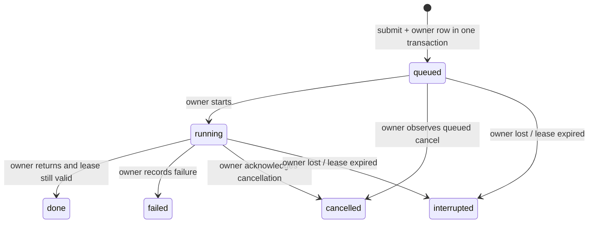

# Job ownership, cancellation และ task outcome — 30 ตุลาคม 2026

ฐาน main dc0b2df; patch jobs 3eef7379/0c871825 เป็น branch แยกจาก #203 และไม่แตะ plan approval ของ Claude ไม่มี paid API, model evaluation หรือเปิด write routes ใหม่

## ปัญหาที่แก้

ก่อนแก้: instance A กำลังรันงาน การสร้าง B บน DB เดียวกันเปลี่ยนทุก queued/running เป็น interrupted; cancel ที่ A จึงคืน interrupted โดย task ยังทำงานอยู่

หลังแก้: ตารางประกอบ `agent_job_owners` เก็บ opaque owner token, host/PID namespace, PID/process start, lease expiry, cancel request และ task outcome ไม่เก็บ goal/answer ซ้ำ Constructor/read จะ interrupt เฉพาะ owner ที่ยืนยันว่าตาย, lease หมด หรือ legacy row ที่ไม่มี owner ไม่ reset งานของ live worker เพียงเพราะสร้าง service ใหม่

## State และ semantics

Cancel request เป็น flag แยกจาก state: worker อื่นบันทึก request แต่ไม่ประกาศ cancelled ก่อน owner ตอบรับ ค่า heartbeat 1 วินาที lease default 30 วินาที (กำหนดผ่าน constructor สำหรับ tests/deployment); expired jobs ไม่ถูก reassign/replay อัตโนมัติ

ทุก state/result update ตรวจ owner token, live state และ lease ภายใน SQLite transaction จึงกัน stale worker เขียนคำตอบหรือผลสำเร็จหลังเสียสิทธิ์ได้ หาก cancel ถูกบันทึกแล้ว runner กลืน CancelledError และคืนคำตอบ ระบบไม่บันทึก done แทนการ cancel

Public methods `submit/get/list/cancel/wait` และ raw `status` เดิมยังอยู่ `wait` ของ observer ที่ไม่มี local task จะอ่านสถานะจาก DB จน terminal/timeout callback on_done ส่งเฉพาะ terminal result ที่ worker นี้บันทึกสำเร็จ

`status=done` หมายถึง runner return เหมือนเดิม เพิ่ม fields:

| Field | ความหมาย |
|---|---|
| cancel_requested | คำขอยกเลิกถูกบันทึก ไม่ใช่การยืนยันว่า external effect หยุดแล้ว |
| task_outcome=pending | runner ยังไม่คืน outcome |
| waiting | plan/question/approval ต้องรอคน แม้ transport status เป็น done |
| completed_unverified | llm_finished โดยไม่มี typed verification ที่พิสูจน์ผล |
| verified | scoped verifier/contract ยืนยันผล ไม่ใช่ความสำเร็จทั่วไปทุก domain |
| unconfirmed | ยังยืนยัน task outcome ไม่ได้ |
| failed/cancelled/interrupted | บันทึก lifecycle ตามสถานะนั้น |
| verification_scope | declared_predicates หรือ document_bytes_and_same_currency_arithmetic เมื่อ verified |

Budget outcome ต้องมี acceptance+semantic satisfied, plan digest ตรง และ receipts ครบ/valid ที่ผูกกับ namespace ของงาน ชื่อ actor ใน receipt ไม่ถูกใช้เป็นผู้ให้ authority ให้ตัวมันเอง

## ข้อจำกัดและ deployment

- Fencing นี้คุม DB writes ไม่สามารถเรียกคืน thread หรือ external API ที่ dispatch ไปแล้ว ใช้ journal, destination idempotency และ reconcile_by_receipt เดิมก่อน retry effects
- Lease ไม่ใช่ distributed consensus และไม่มี automatic work takeover การใช้ SQLite ข้ามเครื่อง/clock skew/partitions ยังไม่ได้ certify
- ต้อง drain/stop workers รุ่นเก่าก่อน upgrade เพราะ worker เก่าไม่รู้จัก fencing token; ไม่อ้าง zero-downtime mixed-version safety
- legacy queued/running ที่ไม่มี owner ถูกมองเป็น interrupted/unknown ตาม compatibility เดิม ไม่เดาว่า effect ไม่เกิด
- หาก DB ใช้งานไม่ได้ heartbeat จะ cancel local runner; ถ้าเขียน acknowledgement ไม่ได้ต้องรอ status reconciliation ไม่แต่ง receipt ว่า cancelled แล้ว
- Audit ของ jobs ยังคง best-effort เดิม patch นี้ไม่อ้าง atomic job audit delivery ส่วน atomic intent-contract audit เป็นอีก patch ต่อจาก #203
- Outcome เป็นผลที่บันทึกตอนจบ ไม่ใช่ approval หรือสิทธิ์ทำ effect ใหม่ และไม่รับรองว่าหลักฐานยังอยู่หลัง erasure
- ไม่มี public endpoint/schema เปลี่ยนเพื่อต่อ read-only budget เข้ากับ generic jobs โดยอัตโนมัติ

## Tests และ handoff ให้ Claude

ใช้ SQLite/async tasks จริง, fake clock สำหรับ expiry ไม่ใช้หน้าต่างเวลาทดสอบต่ำกว่า 1 วินาที มี POSIX skip พร้อมเหตุผลสำหรับ fork/SIGKILL; ข้อความ fixture เขียน UTF-8

18 tests ใหม่: live service ตัวที่สอง, cancel ข้าม instance/คนละ process, queued cancel ไม่ dispatch, expiry, stale token, heartbeat, per-actor denial, cancel แม้ runner กลืน cancellation, atomic capacity limit, unknown remote host PID, kill owner ไม่ replay, และ verified budget outcome พร้อม negative receipts/actor/digest checks

Regression jobs/webhook/partial report/journal/idempotency รวม 124 passed ใน 19.02s (ชุดทับซ้อน ไม่รวมกับ full suite) Ruff ผ่าน, Mypy --platform linux ของสอง source files ผ่าน ผล full suite และ combined tree บันทึกท้ายเอกสารเมื่อรันจบ

ให้ Claude เพิ่มใน W09 oracle: (1) live worker A + constructor B ไม่ interrupt (2) remote cancel ขอแล้วต้องรอ ack (3) stale writer ห้ามเปลี่ยน result (4) waiting outcome ไม่ถูกนับ task success (5) unknown external effect ยังคงต้องตรวจ ไม่ retry เพราะ cancelled flag อย่างเดียว

Claude ยังถือ plan approval hooks/P6/P15, research/live_workflows.py และ Desk UI Codex ไม่แก้พื้นที่เหล่านั้นใน patch นี้

## หลักฐาน full jobs branch

Runtime source 0c871825 บน main dc0b2df: **9,076 passed / 12 failed / 45 skipped / 1 xfailed**, 8989 warnings, 622.85s ไม่วัด coverage

12 failures ยังเป็น 9 model prerequisites, 1 crawler/native DNS และ 2 installer checker ที่ #202 แก้แยกไว้ Jobs branch อิสระนี้ยังไม่รวม #202/#203/atomic-contract patch จึงไม่อ้างว่า failures เหล่านั้นถูกปิดใน branch นี้

Combined integration checkout ใช้ #203 + atomic runtime ade30b9a + jobs 0c871825 + installer 9c90ee1f ที่ local merge commit 641e2e42 ไม่มีการ merge เข้า main ผล combined suite บันทึกเพิ่มเมื่อจบ ห้ามบวกจำนวน focused/full ที่ทับซ้อนกัน และไม่ย้ายตัวเลข cloud นี้ไป canonical main checkpoint
