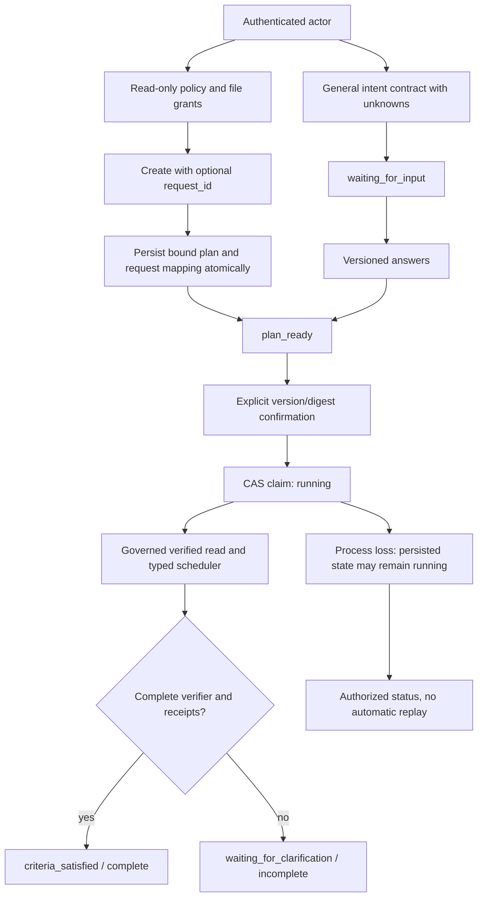

# Backend lifecycle audit และ request idempotency — 30 ตุลาคม 2026

ฐาน: main `dc0b2df373a29edad6d9b328fbcf2e0a73910038` หลัง #199; patch แรก `1113c5d3` บน branch Codex ใหม่ แยกจาก #168 ที่ปิดแล้ว ไม่มี paid API ไม่มีการเปิด write tools หรือ deploy

## Ownership ที่ยืนยันจาก Claude

Claude อยู่ branch `round105/w09-w12-live-runners` ที่ dc0b2df, clean ตามรายงานที่ผู้ใช้ส่งต่อ รับ research/live_workflows.py, research/daaes และ Desk/docs ไม่แก้ api.py/governed_autonomous_loop.py/jobs.py ระหว่าง Codex ทำ backend

Codex รับ contract/authorization/recovery; ส่วน plan approval `_plan_intercept`, `_plan_first_kind`, `_finalize_plan`, `_execute_plan`, `_execute_approved` และ property P6/P15 ยังเป็นของ Claude การทำ patch นี้ไม่เปลี่ยน jobs API หรือ plan approval

ไฟล์ใน checkout เก่าที่แก้/ไม่ track จาก 23 ต.ค. ถูกเก็บไว้ ไม่ได้ย้ายทับ main หรืออ้างว่าเป็นงานที่ยังขาดโดยไม่ได้ diff

## สิ่งที่แก้รอบนี้

`BudgetRequest.request_id` เป็น optional ASCII identifier ยาว 1..128 ตัว `[A-Za-z0-9._:-]` ไม่ใช่ token/password

- ไม่ส่ง request_id: behavior เดิม สร้างแผนใหม่
- ส่ง key เดิม + input เดิม: คืน persisted contract ปัจจุบัน ไม่สร้างแผนซ้ำ ไม่ claim และไม่ dispatch tool
- input ที่ผูก: goal, criteria, workspace root, planning context และ service binding (รวม profile/actor/workspace/executor/policy digest)
- key เดิม + input/policy ต่าง: 409 ไม่ย้าย authority ไป contract ใหม่
- คนละ actor ใช้ key ชื่อเดียวกันได้ โดยได้คนละ contract
- mapping key และ contract insert อยู่ transaction เดียว `BEGIN IMMEDIATE` มี unique(namespace,key_sha256); key เก็บเป็น hash ไม่เก็บ request_id/plain request ในตารางใหม่
- failed transaction/kill ก่อน insert ไม่ทิ้ง orphan key; kill หลัง commit ก่อนตอบกลับ retry แล้วค้น contract เดิมได้
- key ไม่ใช่ permission ทุก HTTP retry ยังต้องผ่าน auth, file grants และ policy check
- response เป็นสถานะล่าสุดของ resource ไม่ใช่ replay response bytes เดิม หาก contract running/completed จะคืนสถานะนั้น ไม่ reset กลับ plan_ready

ตัวอย่างเพิ่มจาก request v1 เดิม:

```json
{"schema_version":"1","executor_version":"verified_budget_v1","workspace_id":"review","budget":"15000 THB","evidence":{"relative_path":"quote.json","sha256":"<64 lowercase hex>"},"request_id":"review-20261030-001"}
```

เป็น additive schema change endpoint เดิม ไม่มี general/write fallback และไม่แตะ idempotency.py ของ tool calls ซึ่งแก้คนละปัญหา

## แผนผัง authority และ state ที่ตรวจแล้ว



เส้น general intent contract กับ read-only profile ใช้ authority/endpoint ต่างกัน ไม่ได้เชื่อมข้าม route จาก diagram อัตโนมัติ

| กลไก | State/บทบาท | ขอบเขต |
|---|---|---|
| intent_contracts | waiting_for_input → plan_ready → running → criteria_satisfied / waiting_for_clarification / interrupted | version/CAS, plan digest, actor namespace; snapshot receipts |
| ClarificationStore | PENDING → ANSWERED / CANCELLED / EXPIRED; consumed/released answer | exact goal/person/version; คำตอบไม่ใช่ approval |
| approvals | pending/approved/execution/outcome reconciliation ตาม implementation | signed effects; ใช้ reconcile_by_receipt เดิม ไม่ทำ store ซ้ำ |
| JobService | queued/running/done/failed/cancelled/interrupted | done หมายถึง runner คืนค่า ไม่รับรอง task success ต้องอ่าน stopped_reason |
| EpisodeJournal | begin, steps, finish/resume claim | durable observations ของ episode; unknown effect ห้าม replay โดยเดา |
| partial_report | finished, safe_to_rerun, outcome_unknown | ใช้ประเมินผลบางส่วน ไม่แทน receipt ปลายทาง |
| idempotency.py | stable key ของ effect/tool call | ปลายทางต้อง honor key จึงกัน effect ซ้ำได้ ไม่ใช่ HTTP create idempotency |

## E2E ที่ทดสอบเพิ่ม

General API จริง + per-user token + SQLite + MCP no-follow + fixture kernel (ไม่มี LLM):

1. ส่งโจทย์ไทยเทียบงบ โดยยังไม่รู้ budget
2. รับ waiting_for_input ไม่มี completion receipt
3. คนอื่นอ่าน contract ไม่ได้ แม้รู้ ID
4. ตอบ budget ตาม current version ได้ plan_ready ใหม่ ยังไม่ execute
5. stale version ถูกปฏิเสธ
6. ยืนยันแล้วอ่าน pinned quote คำนวณ Decimal ตรวจเงื่อนไขและบันทึก receipts ครบ
7. สร้าง API client ใหม่อ่านสถานะจาก DB เดิมได้
8. ยืนยัน completed contract ซ้ำไม่ได้ source bytes ไม่เปลี่ยน

เป็น backend protocol E2E ไม่ใช่ GUI E2E, process restart ทั้ง server หรือ capable-model evaluation การ kill จริงแยกอยู่ชุด create/receipt recovery

## Findings ที่ต้องจัดการต่อ

### F1: JobService หลาย instance ทำให้สถานะและ cancel ผิด

Reproducer บน SQLite จริง: instance A เริ่ม task → running; สร้าง B บน DB เดียวกัน → constructor เปลี่ยนทุก queued/running เป็น interrupted; A.cancel คืน interrupted และ task A ยัง pending

หลักฐาน `/workspace/delentia-lifecycle-evidence-20261030/job-service-multiworker.json` ไม่เปลี่ยน source jobs.py ใน patch นี้ และไม่อ้างว่าปิด failure แล้ว

ทางแก้รอบต่อไป: durable owner/lease + fencing token; expire เฉพาะ owner ที่หมดสิทธิ์ ไม่ reset งานทุกครั้งที่สร้าง service; cancel ที่บันทึกแล้วต้องส่งถึง owner และมี acknowledgement ไม่ใช้ status=cancelled แทนหลักฐานว่า worker/thread effect หยุดแล้ว รักษา public methods ที่ webhook และ W06 ใช้ และแจ้ง Claude ก่อนเปลี่ยน resume semantics ของ W09

### F2: job done != task completed

_run บันทึก done หลัง runner return ทุก stopped_reason รวม waiting/plan_ready/pending approval ใช้ตัวแยก transport completion และ task outcome เพิ่มโดยไม่เปลี่ยนความหมายเดิมแบบเงียบ ต้องมี consumer compatibility tests ก่อนแก้

### F3: contract running ยังไม่มี lease

CAS กัน simultaneous confirm แต่ status ยังแยก alive กับ crashed ไม่ได้ patch นี้คืน state เดิม ไม่ replay อัตโนมัติ request idempotency ไม่ใช่ execution recovery

### F4: contract/audit commit window

contract กับ request mapping atomic แต่ append_audit เดิมอยู่ transaction ถัดไป kill หลัง commit อาจมี contract โดย audit append ยังไม่เกิด retry ค้น state เดิมได้ แต่ไม่ซ่อม audit ที่ขาดให้เอง ต้องออกแบบ outbox/reconciliation ห้ามอ้าง atomic audit delivery

### F5: retention/erasure

ตาราง request keys ไม่มี TTL และผูก namespace/contract ID เก็บ digest ไม่ใช่ข้อความโจทย์ดิบ แต่ยังเป็น metadata inventory การลบข้อความ contract ต้องไม่ถูก bypass ด้วย retry key ห้าม reset/recreate erased intent อัตโนมัติ ควรกำหนด tombstone/retention และ review ร่วมกับ erasure owner ก่อน pilot

### F6: GUI baseline ยังไม่ผ่าน

main GUI CI run 40989051680 ล้มขั้น accessibility ใน browser; log download Forbidden และ artifacts API ไม่คืน artifact จึงยังไม่มี violation ที่ยืนยันได้ Source script exit 2 อาจเป็น harness failure ต้องไม่สรุปจากชื่อ step ว่าเป็น WCAG violation โดยไม่มี log

Claude รับ Desk/accessibility; Codex ไม่แก้ UI และไม่ข้าม axe ใน patch นี้

## แผนรอบต่อไปและเกณฑ์จบ

1. **Baseline**: ตรวจผล Python ของ dc0b2df และ CI ของ PR นี้ให้จบ แยก environment failures กับ application failures ทุกข้อ; canonical/public count ใช้ CI main เท่านั้น
2. **Jobs owner/lease/cancel**: tests สอง live workers, restart/expired lease, stale worker finish, duplicate claim, cancel ขณะรอ/อ่าน/thread in flight; ไม่ใช้ timing threshold ต่ำกว่า 1 วินาที
3. **Outcome projection**: preserve old job API, เพิ่ม task outcome และ receipt completeness แยกจาก done พร้อม webhook/W06/W09 oracles
4. **Audit outbox + erasure semantics**: commit window ที่ kill แล้ว recover ได้ โดยไม่แต่ง receipt/audit ว่าบันทึกสำเร็จเมื่อยังไม่เกิด
5. **Desk combined E2E**: Claude pin backend SHA/schema; plan→questions→confirmation→verdict/receipts→reconnect พร้อมไทย/อังกฤษและ accessibility บน topology same-origin จริง
6. **Model evaluation**: Claude ทำ W09/W12 live runners Codexช่วย protocol/verifier oracle; pin model/provider/settings/policy/code และ holdout แยก dev ไม่ใช้ paid API ตาม standing instruction
7. **Domain verifier และ operations**: เพิ่มทีละ domain หลัง acceptance coverage; restore/witness/notary separation/72h soak/outside review ต้องมี host evidence ไม่ใช้ local tests แทน

## นิยามสถานะ

Delentia เป็น self-hosted experimental intent-centric agent runtime ที่มี governance, signed approvals, persistent contracts/journal, bounded execution/verifiers, clarification และ Desk สำหรับการใช้งานภายใต้การดูแล เพิ่ม retry-safe request creation ในรอบนี้ แต่ยังไม่ครบ autonomous RCT-7 ทั่วไป และยังไม่รับรอง multi-worker jobs หรือ L2 pilot readiness

ไม่มีเปอร์เซ็นต์ความสมบูรณ์ที่นิยาม denominator ได้ ใช้ workflow acceptance gates, model false acceptance/false pause, receipt completeness และ operational evidence เป็นเกณฑ์แทนจำนวน tests หรือเลขเวอร์ชัน

## ผลทดสอบและขอบเขตที่ส่งมอบ

| การตรวจ | ผล | ขอบเขต |
|---|---|---|
| Full Python ที่ implementation 1113c5d3 | 9,077 passed / 12 failed / 45 skipped / 1 xfailed, 8992 warnings, 630.14s | Python 3.12, xdist 3 workers, browser runner, PostgreSQL; ไม่วัด coverage |
| Backend regression รวม HTTP lifecycle test ใหม่ | 137 passed, 178 warnings, 3.90s | auth, contract, verified budget, clarification และ idempotency; ทับซ้อน full suite |
| Installer patch แยก | 30 passed, 14 warnings, 6.10s | Linux virtualenv; ไม่ใช่ Windows install จริง |
| Ruff | ผ่าน | core/signedai/rct_control_plane/microservices |
| Mypy --platform linux | ผ่าน 2 changed source files | intent_contract.py และ readonly_service.py |
| MkDocs --strict | ผ่าน | เอกสารและ schema update |

12 failures ของ full run: 9 ต้องใช้โมเดล Ollama, 1 crawler/native DNS, 2 installer checker สองกรณีหลังทำซ้ำ isolated ได้ พบ checker resolve Python ของ venv ไป base interpreter ทำให้ metadata 2.3.1/2.4.1 ต่างกันและ startup fail แก้ใน branch แยกโดยรักษา executable path ด้วย absolute() แทน resolve(); ชุด installer 30 กรณีผ่านแล้ว ยังไม่ถือว่า full run เปลี่ยนเป็น 10 failures เพราะไม่ได้รัน full combined tree ใหม่

Full suite สะท้อน cloud prerequisites ปัจจุบัน ไม่แทน CI main และไม่ย้ายตัวเลขนี้ไป README/public checkpoint ไม่มี paid API หรือ capable-model evaluation ตัวเต็ม รายงานเครื่องอ่านได้: evidence/LIFECYCLE_2026-10-30.json

สิ่งที่ยังไม่ได้ปิดในรอบนี้: GUI accessibility (Claude), jobs multi-worker lease/cancel F1, outcome semantics F2, audit outbox F4, retention/erasure F5, model/DNS prerequisites และ operational pilot gates ทุกข้อยังต้องมี acceptance evidence แยกกัน

ข้อความส่งต่อให้ Claude: request_id ของ budget create เป็น optional/additive และไม่เปลี่ยน idempotency.py/episode journal/plan approval หรือ jobs API; ระวัง JobService instance B เปลี่ยนงานที่ A ยังทำอยู่เป็น interrupted และ cancel ไม่ถึง task เดิม จึงควรมี case นี้ใน W09 oracle ก่อนออกแบบ lease/recovery รอบต่อไป
