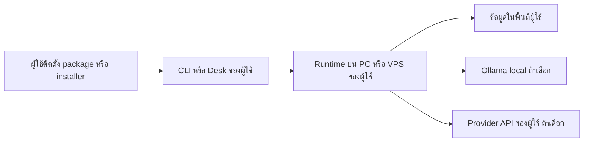

# Local-first open-source release — 2026-10-30

## เป้าหมายที่ Architect ยืนยัน

เปิดตัวเพื่อให้ผู้ใช้ **ติดตั้งและรัน Delentia บนเครื่องหรือ VPS ของตนเอง** ใช้ model/API key/data directory ของตน ไม่ใช่เปิด Delentia-operated shared host ให้สมัครใช้ เอกสารนี้แทนการตีความ release blockers ในรายงาน cloud ก่อนหน้าที่ให้น้ำหนัก shared pilot มากเกินไป ไม่เปลี่ยนผลทดสอบหรือข้อจำกัดของ implementation เหล่านั้น

[NousResearch/hermes-agent](https://github.com/NousResearch/hermes-agent) เป็น reference ของ install/setup/provider journey ตามที่ Architect ยก ไม่ใช่การอ้าง feature parity หรือความสามารถเทียบเท่า Hermes

API loopback เป็น process ของ installation นั้น ไม่ใช่บริการกลางของ Delentia Local installation ที่เลือก cloud model ยังส่ง prompts ไป provider นั้น ผู้ใช้ไม่ต้องมี public endpoint เพื่อเริ่มทดลอง

## การพัฒนารอบนี้

- `doctor` default ตรวจ installation โดยไม่ต้องมี repository, .env, pyproject.toml หรือ development services ห้าพอร์ต ไม่มี model call
- source/service checks เดิมเป็น opt-in `doctor --development`; JSON เพิ่ม scope/not_checked และปัญหาจริง exit 1
- setup home precedence: `--home` → `DELENTIA_HOME` → `~/.delentia`; model path precedence: `DELENTIA_MODEL_CONFIG` → `<DELENTIA_HOME>/model.json` → `~/.delentia/model.json`
- install-contract checker ตรวจ doctor ใน installed wheel จากโฟลเดอร์ว่างด้วย ไม่ใช้ editable install แทน clean installation
- build wheel ที่บรรจุ Desk assets; ทดลอง local API, scripted demo, memory/restart และ package read-only ด้วย existing checker

PR นี้เริ่มจาก main และรวม main update ของ #206/#208 ที่ merge ระหว่างทำงาน ไม่พึ่ง #203–#210 ทั้งชุดเพื่อให้ onboarding ใช้งานได้ ไม่แก้ research/budget guard/Desk source หรือ public checkpoint ของ Claude

## Home/upgrade compatibility

ถ้าไม่ตั้ง DELENTIA_HOME default model path ยังเดิม หากรุ่นเก่าตั้ง custom DELENTIA_HOME แต่ model config อยู่ ~/.delentia/model.json ให้บันทึก path จาก model show แล้วตั้ง DELENTIA_MODEL_CONFIG ชี้ไฟล์เดิมก่อน upgrade หรือย้าย config อย่างตั้งใจ ไม่มี automatic migration หรือการย้าย private keys ให้เอง

`--home` ของ setup ไม่เปลี่ยน environment ของ server อีก terminal และ audit/approver paths ยังมี explicit configuration ของตน ต้องทำตาม instructions ของ setup ไม่อนุมานว่าทุก subsystem ย้ายตาม DELENTIA_HOME

## Gates ที่ตรงกับเป้าหมาย

| เรื่อง | ก่อน paid research ของผู้สร้าง | ก่อน local/self-managed preview | Shared service ในอนาคต |
| --- | --- | --- | --- |
| Revision/CI/artifact | pin revision ของ experiment | package/installer/checksum ของ revision ที่ตรวจแล้ว | deployed revision ที่ตรวจแล้ว |
| Installation | runner reproduce ได้ | clean install/first task/diagnostics บน OS ที่ประกาศรองรับ | deployment procedures เพิ่ม |
| Model/keys/budget | explicit model/provider/caps และ authorization | BYOK/BYOM พร้อมคำอธิบายข้อมูลและค่าใช้จ่าย | operator/tenant controls เพิ่ม |
| Capability evidence | canary → batteries → holdout | อ้างเฉพาะผลจริง; scripted ไม่แทน model success | ตรง workflow/users/host ที่เปิด |
| GUI | ต้องผ่านถ้า experiment ใช้ Desk | local user journey ที่สัญญาไว้และ demo จริง | shared identities/reconnect เพิ่ม |
| State lifecycle | reproducible results/state | local persistence, backup/upgrade/uninstall guidance | centralized operations เพิ่ม |
| Independent witness/notary isolation/72h soak | ไม่ใช่ prerequisite ทั่วไปของ isolated read-only research | ไม่บังคับให้ทุกคนตั้ง shared-host stack ก่อนทดลอง; คง feature/security limitations | คง gates ก่อนเปิด shared deployment |

เป้าหมายนี้ตรง L1 Local experimental alpha ใน RELEASE_LEVELS G-host/G-witness ของ shared host ไม่บล็อก L1 แบบเหมารวม แต่ห้ามอ้าง tamper-proof audit, isolated approval keys หรือ unattended reliability หากยังไม่มีหลักฐานของคุณสมบัตินั้น

## แผนลำดับต่อไป

1. **Local install contract:** review PR นี้และ #202 สำหรับ Windows installer interpreter; build artifacts/checksums; Linux wheel clean install, doctor, scripted demo, API/Desk loopback, memory/restart, read-only package และ uninstall ที่คงข้อมูล
2. **Platform evidence:** Claude ตรวจ Windows native first-run/SmartScreen/upgrade และ GUI ส่วน macOS ต้องมี native evidence ก่อนขยายคำรับรอง ไม่ใช้ Linux ทดแทนทุก OS
3. **Budget guard:** Claude ปิด finite/nonnegative inputs และ in-flight accounting พร้อม negative/concurrency/crash tests ยังไม่ถือว่าปิดจาก tests เดิมที่ผ่าน
4. **Freeze experiment:** code/model/provider/routing/settings/prompts/schema/policy/roles/price/caps ระบุครบ; แยก development/holdout; Architect อนุมัติวงเงินรวม/ต่อ run/reserve/provider cap
5. **Free rehearsal → paid canary:** exact configuration ครอบคลุม auxiliary/children/retries ที่เปิด; เทียบ fake endpoint กับ ledger ก่อน แล้วทีละ paid run เก็บ actual usage/bill/unknown outcomes
6. **Capability/holdout:** whole-workflow oracle และ raw outcomes วัด task success/false acceptance/clarification/latency/cost ไม่ใช้ deterministic executor แทนความสามารถโมเดล
7. **Local Desk E2E/video:** install/setup → first task → plan/clarification/confirmation ตาม workflow → result/verdict/receipts → restart บน combined release SHA ไทย/อังกฤษ identity/cancel/reconnect และ failure path
8. **Self-install trial:** ผู้ทดลองทำตามคู่มือบนเครื่องของตน จดเวลา/จุดติดขัด ไม่ต้องเข้า shared service ของผู้สร้างเพื่อให้ feedback
9. **Marketing:** CTA Download/Install → free scripted demo → own model → scoped task → feedback; release notes/support matrix/privacy/update/uninstall/known limits ตรง artifact และ public numbers ใช้ main CI

Local Ollama/DNS prerequisites ปิดตาม workflow ที่ใช้ ไม่จำเป็นต้องรอ cloud Ollama เพื่อทดลอง OpenRouter บน fixtures และไม่ลด SSRF/sandbox เพื่อทำให้ tests ผ่าน Runtime experimental และ semantic RCT-7 ยังไม่ครบทุก domain ต้องระบุขอบเขตตามจริง

## งานที่ไม่ใช้ขวางการเปิดตัวรอบแรกแบบเหมารวม

Delentia-operated shared host, tenant operations, off-host witness ของ host กลาง, notary แยก user บนเครื่องกลาง, centralized restore/72h soak และ shared-host outside pilot เป็น future deployment milestone หากภายหลังเปิด surface นั้น gates เดิมยังใช้ ส่วน advanced signed writes/autonomy แยกเป็น opt-in workflows ที่ต้องพิสูจน์ ไม่ใช่ข้ออ้างให้ลด gate ของ feature นั้น

## การแบ่งงานและข้อมูลที่ยังขาด

Codex ดู CLI/setup/config และ installed-wheel/local lifecycle tests; Claude ดู research budget/holdout/live runners, Desk/Windows และ public release evidence ตามขอบเขตเดิม ไม่ force-push branch ของกันและกัน

ก่อน paid call ยังต้อง model ID/provider/routing และวงเงินจริงที่ Architect กำหนด Defaults/estimates ไม่ใช่ authorization ไม่ส่ง keys ในแชท ไม่มี paid calls ในรอบนี้

คู่มือผู้ติดตั้งของ branch นี้: [SELF_INSTALL_PREVIEW_TH](../demo/SELF_INSTALL_PREVIEW_TH.md) ผลทดสอบจริงและ hashes บันทึกใน evidence ประกอบ PR ไม่เปลี่ยน release gate status อัตโนมัติ

## ผลตรวจของ implementation รอบนี้

- Integrate main `d1376d21` และ fix เดิม #202 ใน branch `codex/local-first-onboarding-20261030`, PR #212 ที่ target main โดยตรง
- Full Python หลังตรวจ test services: **9,085 passed / 10 failed / 45 skipped / 1 xfailed / 0 setup errors**, 627.19 วินาที เหลือ 9 missing-Ollama-model และ 1 native-DNS crawler; ไม่ทำให้ผ่านโดยข้าม tests/sandbox/SSRF
- Focused **219 passed** รวม 8 added onboarding cases; PostgreSQL/installer recovery **37 passed**; หลังแก้ type annotation ของ checker มี regression **16 passed** จำนวนซ้อนกัน ไม่บวกยอด Full run เริ่มจาก runtime base cf8d8b89 และ follow-up a49237d8 เปลี่ยนเพียง annotation ไม่มี runtime logic ใหม่
- Ruff, Linux Mypy 5 files, MkDocs strict, claim sync และ version checks ผ่าน
- Wheel local 2.4.1 (ยังไม่ release) มี Desk assets 233 files, ติดตั้ง venv ว่างจริง, pip check clean, install contract ผ่าน **6/6 groups** รวม scripted demo/API/memory/restart/package read-only
- Installed launch เริ่ม API/Desk/readiness HTTP200, Thai memory roundtrip และ stop ปิดสอง ports ได้ ไม่ใช่หลักฐานการคลิก contract chat E2E หรือ real model
- Synthetic 2.4.0 → 2.4.1-local → 2.4.0 → uninstall → 2.4.1-local คง memory และ model config ที่ pin path ไว้ได้; local backup/verify/restore ไป directory ใหม่อ่าน memory/model ได้เมื่อรวม synthetic keys ไม่รับรอง arbitrary schema rollback, off-host restore หรือ erased-data reconciliation
- CI package check ของ head a49237d8 ผ่านที่ run 41016750394 ก่อนหน้านี้ build/package Desk เคย fail และ signed log download ถูก Forbidden; run เดิมภายหลัง rerun ผ่าน ยังไม่ทราบสาเหตุเดิม ไม่อ้างว่าแก้จากการคาดเดา
- รอบ full ก่อนแก้ prerequisites ได้ 9077 passed/11 failed/7 setup errors: task PG/Ollama containers หยุดพร้อมกัน exit255, OOMKilled=false เวลา 06:17:48 UTC ไม่พบเหตุระดับแพลตฟอร์มที่ยืนยันได้ รันใหม่หลัง start/health check และรวม #202 แล้ว จึงใช้ผลหลังแก้เป็นหลัก Docker/PostgreSQL เป็น test harness ไม่ใช่ dependency ของ demo ปกติ

หลักฐานและ hashes: [LOCAL_FIRST_INSTALL_VALIDATION](evidence/LOCAL_FIRST_INSTALL_VALIDATION_2026-10-30.json) และ [release scope](evidence/SELF_INSTALL_RELEASE_SCOPE_2026-10-30.json) ไม่ใช้ยอด cloud แทน main CI checkpoint ไม่มี paid model calls, merge main, release tag, package publish หรือ marketing post ในรอบนี้

Windows CI ของ head a49237d8 ผ่าน Build/install/check/uninstall แล้ว ยังไม่แทน manual Desk/SmartScreen/ผู้ใช้ภายนอกติดตั้งเอง macOS ยังไม่มี native evidence ในรอบนี้ ยอด test ต่างจาก PR #210 เพราะ PR นี้ทดสอบ main-based scope โดยไม่รวม jobs stack ไม่ใช่หลักฐานว่างานเก่าถูกลบ งานเหล่านั้นยังอยู่ใน PR ของตน
