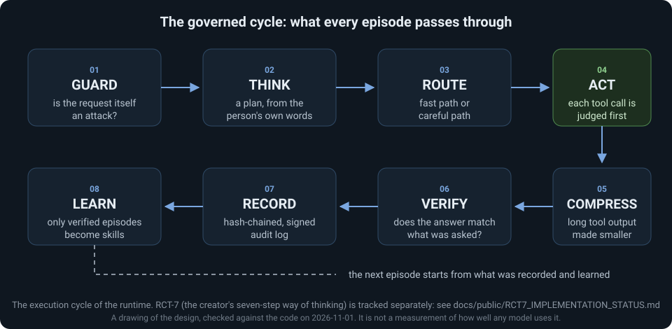
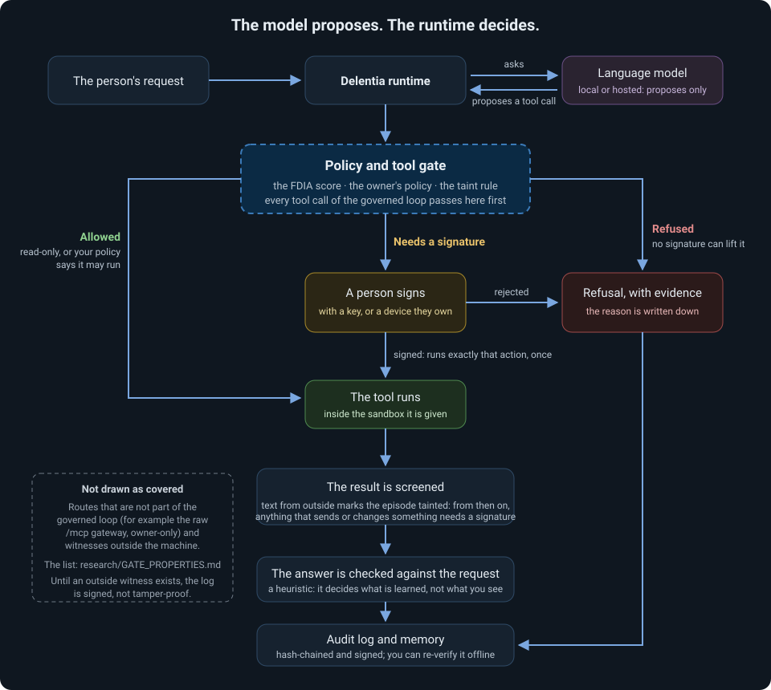

# Delentia OS

**A self-hosted AI agent runtime in which the model only proposes. Every tool call is judged before it runs, anything that writes, sends or runs code waits for a person's signature, and every episode leaves a record you can verify.**

!!! warning "Experimental research software"
    Delentia OS is a research project by one creator. It is not production-stable, no strong hosted model has driven it yet, and nothing here runs anywhere except on your own machine. [What is measured, and what is not](#what-is-measured-and-what-is-not).

## What it is

AI agents can plan and use tools. What happens when the model misreads you, reads a hostile web page, or the process dies halfway through a job? Most setups rely on the model behaving. Delentia OS does not: the runtime sits between the model and the tools and decides.

- **Governed tool use.** A gate (a score, your own policy, and a rule about untrusted text) judges each call. Reading is quiet; writing, sending and running code stop and wait for a signature from a key or a device you own.
- **A rule for hostile content.** Text that comes from outside marks the episode as *tainted*; from then on anything that could send or change something needs a signature, whatever the model says.
- **Verifiable records.** Each episode is written to a hash-chained, signed audit log you can re-check offline.
- **Your model, your machine.** A local model (Ollama), any OpenAI-compatible endpoint, or OpenRouter.

## The governed cycle

Every episode passes the same fixed cycle: **GUARD** (is the request itself an attack?) → **THINK** (a plan) → **ROUTE** (fast or careful) → **ACT** (each tool call is judged first) → **COMPRESS** (long tool output made smaller and recoverable) → **VERIFY** (does the answer match what was asked?) → **RECORD** (a signed, hash-chained audit log) → **LEARN** (only verified episodes become skills). RCT-7, the creator's seven-step way of thinking, is a separate thing, tracked in [its own status page](public/RCT7_IMPLEMENTATION_STATUS.md).

## Where the model stops and the runtime decides

The drawing shows the governed loop. It does not claim that every route into the system passes the gate: the routes outside the loop are listed in [the gate properties](https://github.com/delentia-labs/Delentia-OS/blob/main/research/GATE_PROPERTIES.md), and until a witness outside the machine exists the log is hash-chained and signed, **not** tamper-proof.

## The FDIA Equation

$$F = D^I \times A$$

| Symbol | The creator's meaning | What the runtime computes |
|--------|---------|---------|
| **F** | **Future**: the outcome that actually happens | An action-admissibility score, not the future and not a calibrated probability |
| **D** | **Data**: reality and experience, good and bad | A data-evidence score in [0, 1] built from the person's own files, memory and the clarity of the request |
| **I** | **Intent**: the exponent that gives the data direction | A strictness value, about 0.5 to 2, from the kind and risk of the goal |
| **A** | **Architect**: the human who designs, decides and answers for the outcome | The owner's policy plus a verifiable signature for protected actions |

> Because **D** is in [0, 1], a larger **I** makes **F** smaller for the same **D**: a clearer, more demanding intent needs better data to pass. No accuracy figure is claimed for the score; see the [benchmark methodology](benchmark/methodology.md) for what has and has not been measured. The equation has no official expanded name. [The full explanation](reference/fdia-equation.md).

## What is measured, and what is not

| Evidence | Where it stands |
|---|---|
| The public test suite | See [Testing](testing/TESTING_CANONICAL.md) for the current checkpoint, the run and the caveats. It is evidence about the code, not about how well a model uses it |
| The gate against a scripted attacker | A model that obeys every injected instruction: the taint rule stops every harmful side effect in the scenarios tried; method and limits in the [threat model](security/THREAT_MODEL.md) |
| **A strong hosted model driving the runtime** | **No result yet** |
| **Independent reproduction** | **None yet** |
| Production readiness | **Not declared** |

Hallucination rate: not claimed (an earlier 0.3% figure was withdrawn on 2026-09-28 because it could not be reproduced). Memory deltas are 39% (20 ticks) to 90% (500 ticks) smaller than a full snapshot per tick, measured in bytes; plain compression of snapshots does as well, so this is a property of the format, not a claim of being better.

## Start

- **Install:** [Installation](getting-started/installation.md) (Windows installer, `pip install delentia-os`, from source)
- **First run, no model and no key:** [Quick start](getting-started/quickstart.md)
- **What the system is, in one page:** [Current public information](public/CURRENT_PUBLIC_INFORMATION_EN.md) · [Whitepaper 3.0](whitepaper/DELENTIA_WHITEPAPER_3.0_EN.md)
- **Detail that used to be in the README:** [Reference](reference/index.md)
- **Limits and risks:** [Known limitations](KNOWN_LIMITATIONS.md) · [Threat model](security/THREAT_MODEL.md) · [Comparison with other runtimes](COMPARISON.md)

[Get started →](getting-started/installation.md){ .md-button .md-button--primary }
[View on GitHub →](https://github.com/delentia-labs/Delentia-OS){ .md-button }
